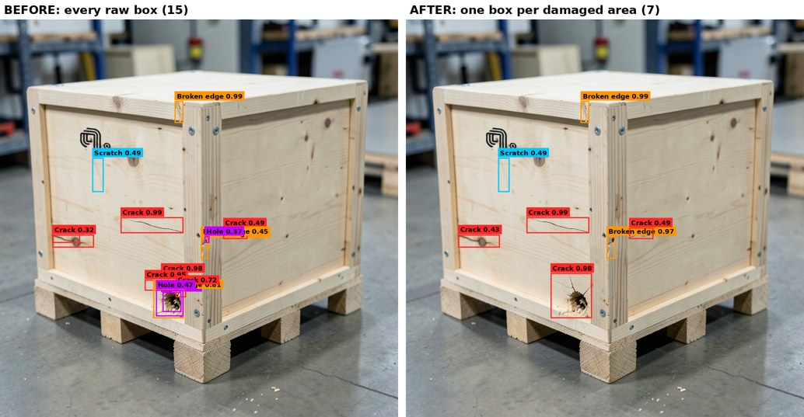
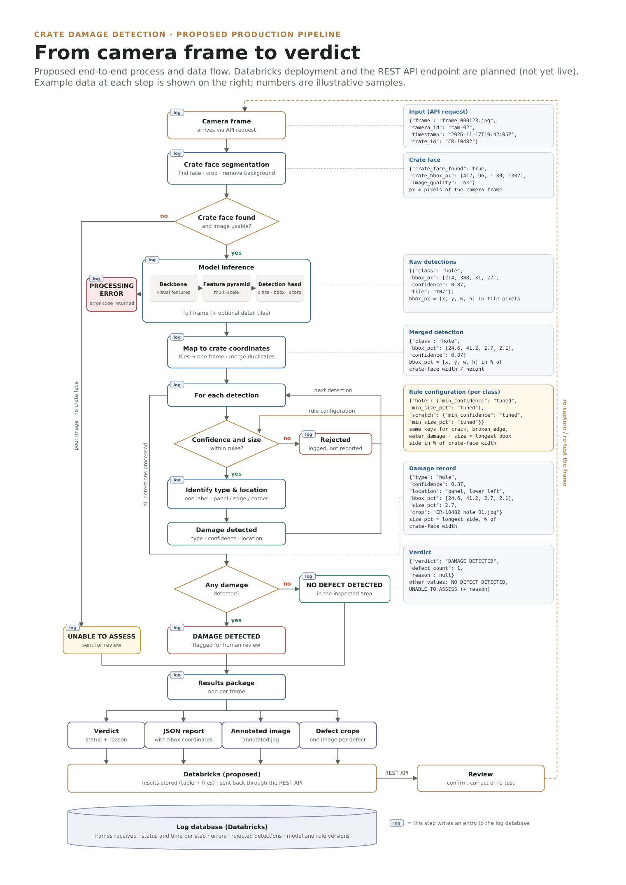

# Crate defect detector: integration guide

This guide is written so that a developer, or an AI coding assistant, can wire the crate defect detector into a production pipeline on Databricks without reading anything else. Everything needed is in this repository: code, all model weights, a Databricks notebook, a self-test and the pipeline diagrams.

---

## 0. TL;DR on Databricks: one cell

```python
PKG  = "/Workspace/Users/<you>/Amat-model/CRATE-DETECTOR-23NOV"   # this folder, cloned or uploaded
MODE = "bigdefect"            # "single" | "ensemble" | "bigdefect" | "single_bigdefect"
DROP = []                     # e.g. ["Water damage"] to hide that class
import sys; sys.path.append(PKG)
from crate_detector import CrateDetector
det = CrateDetector(PKG, mode=MODE, drop_classes=DROP)   # first run joins weight parts into /tmp (~1 min), then loads
```

From then on:

```python
r   = det.predict(image)                 # file path, PIL.Image, or RGB numpy array (H x W x 3)
rep = det.report(r, frame_id="cam2_000123.jpg")   # verdict JSON (see section 4)
img = det.draw(image, r)                 # annotated PIL image, one box + label per damaged area
```

The same cell is ready-made as **CELL 1 - LOAD** in `CRATE-DETECTOR-23NOV/databricks_notebook.py`. In Databricks use Workspace → Import, then run that cell.

**Install:** only needed if the cluster lacks torch/torchvision. It's CELL 0 in the notebook. Use the same pip index URL and trusted host as other AMAT notebooks, and never write that URL into shared files, because it contains a token. `ultralytics==8.4.197` is needed **only** for `MODE="ensemble"`.

---

## 1. What is in the repo

```
CRATE-DETECTOR-23NOV/
  crate_detector.py        the whole library: class CrateDetector (+ merge_areas, report, draw)
  config.json              models per MODE, tested threshold per MODE, drop_classes
  models/*.pt.partNN       8 model weight files, each split into <100 MB parts (GitHub file limit)
  databricks_notebook.py   Databricks notebook - CELL 1 is the only required cell
  run_folder.py            command line: folder of images -> JSONL (+ annotated images)
  selftest.py + selftest/  3 images + expected output -> proves the setup is correct
  GUIDE.txt                full user guide (modes, numbers, limits)
  requirements.txt
docs/diagrams/             pipeline flowcharts (PNG + PDF) - see section 6
docs/images/               before/after of the one-box-per-damage display
samples/                   10 crate photos with expected detections (zip)
```

### Weights (why "parts")

GitHub rejects files over 100 MB, and each Faster R-CNN file is 173 MB. Each file is therefore stored as `<name>.pt.part00`, `<name>.pt.part01`, … These are **plain byte splits**: nothing is converted or compressed.

- `CrateDetector` joins them automatically the first time, into `<tempdir>/crate_detector_weights/` (e.g. `/tmp/...` on Databricks). It never writes into the package folder, so a read-only Workspace or Git folder is fine. Choose another place with `CrateDetector(..., weights_cache="/local_disk0/crate_w")`.
- The joined files are **byte-identical** to the originals. This was checked with `cmp` and SHA-256, and the self-test passes on them.
- To join manually: `cat fr_current.pt.part* > fr_current.pt`, then put the `.pt` in `models/`. A whole `.pt` in `models/` is always used first.

| file | model | used by mode |
|---|---|---|
| fr_current.pt | Faster R-CNN R50-FPN v2, all labels | single, ensemble |
| cur_curriculum.pt | Faster R-CNN, curriculum (big first, then small) | ensemble |
| A16_thin_anchors.pt | Faster R-CNN, thin anchors + augmentation | ensemble |
| y32_yolo11s.pt | YOLO11s (ultralytics) | ensemble |
| mB_bigdefect.pt | Faster R-CNN, big-defect labels | bigdefect, single_bigdefect |
| mBfull_bigdefect.pt | Faster R-CNN, big-defect labels, longer training | bigdefect |
| B_copypaste.pt | Faster R-CNN, copy-paste augmentation | bigdefect |
| C12_bigdefect_crackboost.pt | Faster R-CNN, big-defect + crack oversampling | bigdefect |

---

## 2. Modes: which to pick

The numbers come from the validation set: 701 photos, 3,196 labelled defects, 36 healthy photos. Each mode's threshold is set so that **6 of 36 healthy crates get a box**, which keeps the false-alarm level the same for every mode. Recall here means the box is on the defect with IoU ≥ 0.5 **and** the type is correct.

| MODE | models | all defects | big (≥32 px) | small | damaged photos caught | ms/photo (GPU) |
|---|---|---|---|---|---|---|
| single | 1 | 36.8% | 50.8% | 21.4% | 73.5% | ~70 |
| ensemble | 4 | 41.7% | 56.7% | 25.3% | 78.3% | ~170 |
| **bigdefect** | 4 | 40.7% | **67.8%** | 11.2% | 77.9% | ~185 |
| single_bigdefect | 1 | 32.3% | 56.7% | 5.5% | 71.6% | ~70 |

- **bigdefect** is the default for "find visible damage". Big holes are found 93% of the time and big broken edges 72%.
- **single** is fastest, and its boxes look cleanest on new photos.
- **ensemble** is best when small defects matter.
- Lowering the threshold, e.g. `CrateDetector(..., threshold=0.20)`, finds more defects but flags more healthy crates. For bigdefect at 0.20: big recall goes to 71% and photos caught to 85%, but about 17 of 36 healthy crates get flagged.

---

## 3. Input and output

**Input:** one crate photo, as a path, a `PIL.Image` or an RGB numpy array. The models were trained on 1024×1024 crate photos. Any other size is resized to 1024×1024 for the model, and boxes are mapped back to **original-image pixels**.

**`det.predict(image)` returns:**

```json
{
  "mode": "bigdefect", "threshold": 0.268252, "crate_flagged": true, "image_size": [1536, 1024],
  "damage_areas": [ {"class": "Crack", "score": 0.97, "n_boxes": 4, "box_xyxy": [780, 427, 1102, 583]} ],
  "defects":      [ {"class": "Crack", "score": 0.97, "box_xyxy": [763, 395, 931, 437]}, ... ]
}
```

- **Classes:** `Crack, Dent, Water damage, Scratch, Hole, Broken edge`.
- **`defects`:** every box above the threshold, which is what the models output.
- **`damage_areas`:** **one box and one label per damaged area**. Show these to users. The models often draw several boxes on one damage, such as one per branch of a crack, or a crack box plus a broken-edge box on the same tear. They are merged by these rules:
  1. Boxes that overlap, or sit within 30 px of each other, are the same damaged area, whatever their type.
  2. The area box surrounds all of them. Its label and score come from the most confident box, and `n_boxes` says how many boxes were merged.
  3. Very large boxes (over 25% of the photo) are never merged into others, so one huge box can't swallow the whole crate.
  - This merging is for display only. The recall numbers above are measured on the raw `defects`.
- **`crate_flagged`:** at least one defect above the threshold.



---

## 4. Verdict JSON: `det.report(r, frame_id)`

The output has the same shape as the "Damage record" and "Verdict" boxes in the production pipeline diagram (`docs/diagrams/Crate-Damage-Production-Pipeline.png`):

```json
{
  "frame": "cam2_000123.jpg", "verdict": "DAMAGE_DETECTED", "defect_count": 1, "reason": null,
  "mode": "bigdefect", "threshold": 0.268252,
  "damage": [ {"type": "Crack", "confidence": 0.97, "location": "middle centre",
               "bbox_pct": [50.8, 41.7, 20.9, 15.2], "size_pct": 20.9, "box_xyxy_px": [780, 427, 1102, 583]} ]
}
```

- `verdict` is `DAMAGE_DETECTED` or `NO_DEFECT_DETECTED`.
- `bbox_pct` is `[x, y, w, h]` in % of the **image** width and height.
- `size_pct` is the longest side as a % of image width.
- `location` is a 3×3 grid of the image: upper/middle/lower × left/centre/right.
- **Not in this package yet:** crate-face segmentation. So percentages and location are relative to the whole photo, not the crate face, and `UNABLE_TO_ASSESS` (no crate face or a bad image) is not produced. The pipeline should add those steps; see section 6.

---

## 5. Building the pipeline: suggested code

```python
import json
from crate_detector import CrateDetector
det = CrateDetector(PKG, mode="bigdefect")            # load ONCE (takes seconds); reuse for every frame

RULES = {  # optional per-class rules from the diagram ("Confidence and size within rules?")
    "Crack": {"min_confidence": 0.0, "min_size_pct": 0.0},   # tune later; 0 = keep everything the model reports
}

def inspect(frame_path, frame_id):
    try:
        r = det.predict(frame_path)
    except Exception as e:                            # diagram: PROCESSING ERROR
        return {"frame": frame_id, "verdict": "PROCESSING_ERROR", "reason": str(e)}
    rep = det.report(r, frame_id=frame_id)
    rep["damage"] = [d for d in rep["damage"]
                     if d["confidence"] >= RULES.get(d["type"], {}).get("min_confidence", 0)
                     and d["size_pct"] >= RULES.get(d["type"], {}).get("min_size_pct", 0)]
    rep["defect_count"] = len(rep["damage"])
    rep["verdict"] = "DAMAGE_DETECTED" if rep["damage"] else "NO_DEFECT_DETECTED"
    det.draw(frame_path, r).save(f"/tmp/{frame_id}_annotated.jpg")   # "Annotated image" output
    return rep
```

Defect crops ("one image per defect" in the diagram) can be cut from the image using each record's `box_xyxy_px`.

---

## 6. Pipeline diagrams

| file | what |
|---|---|
| `docs/diagrams/Crate-Damage-Production-Pipeline.png` (.pdf) | full proposed production flow, camera frame → verdict, with example JSON at each step |
| `docs/diagrams/Crate-Damage-Pipeline-TECHNICAL-flowchart-only.png` | technical flowchart |
| `docs/diagrams/Crate-Damage-Pipeline-7-STAGE-flowchart-only.png` | simplified 7-stage version |

| diagram step | where it is |
|---|---|
| Camera frame (API request) | your pipeline |
| Crate face segmentation, "crate face found?" | **not in this package**; existing separate segmentation model; add before `predict` |
| Model inference (backbone → feature pyramid → detection head) | `det.predict()` |
| Map to coordinates, merge duplicates | `predict()` returns original-image px; `damage_areas` = merged |
| Confidence and size within rules? | threshold per MODE is built in; extra per-class rules: section 5 |
| Identify type & location, damage record | `det.report()` |
| Verdict, JSON report, annotated image, defect crops | `det.report()`, `det.draw()`, crop with `box_xyxy_px` |
| Databricks storage, REST API, log database, review | your pipeline (planned) |



---

## 7. Check the setup

```bash
cd CRATE-DETECTOR-23NOV && python selftest.py      # GPU: must print ALL OK
python run_folder.py . photos/ results.jsonl --mode bigdefect --draw annotated/
```

On CPU, `single` and `single_bigdefect` match exactly. The 4-model modes can differ by a few boxes near the threshold, because two models run half precision on GPU. That's expected.

**Tested with:** Python 3.10, torch 2.14.1, torchvision 0.29.1, ultralytics 8.4.197, RTX A5000. On CPU, expect about 1–3 s per photo per model.

---

## 8. Known limits (tell users)

- Numbers are on the validation set. The held-out test set hasn't been scored yet.
- Small defects under 32 px (hairline cracks, fine scratches) are mostly missed, especially in `bigdefect`.
- Known false alarms on new photos:
  - knots reported as **Hole**;
  - plain, darker orange plywood panels reported as **Water damage**. To hide that class, set `drop_classes=["Water damage"]`.
- Big branching cracks can come back as several pieces. `damage_areas` merges them for display.
