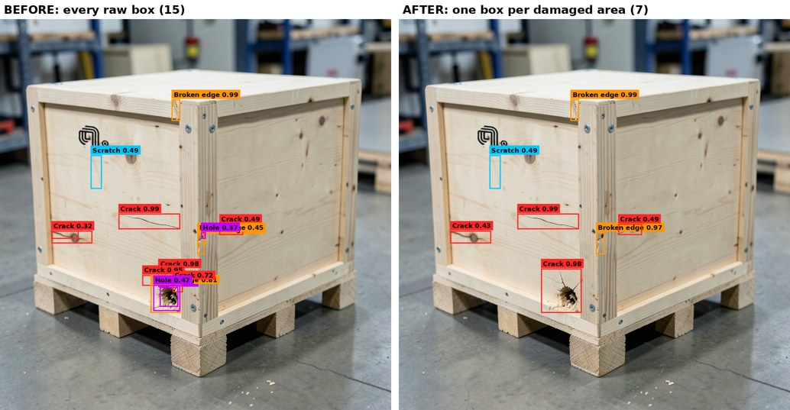

# Amat-model: crate defect detector

Detects damage on wooden shipping crates: **Crack, Broken edge, Hole, Scratch, Water damage, Dent**. It returns one box and one label per damaged area, plus a verdict JSON.

**The model weights are in this repo**, in `CRATE-DETECTOR-23NOV/models/`. Each file is split into parts under 100 MB because of GitHub's file size limit. The code joins them back automatically into byte-identical files, so clone and run.

**Start here: [INTEGRATION-GUIDE.md](INTEGRATION-GUIDE.md)** covers Databricks setup in one cell, the output format, the verdict JSON, pipeline code and diagrams.

```python
import sys; sys.path.append("CRATE-DETECTOR-23NOV")
from crate_detector import CrateDetector
det = CrateDetector("CRATE-DETECTOR-23NOV", mode="bigdefect")   # single | ensemble | bigdefect | single_bigdefect
r = det.predict("crate.png")
r["damage_areas"]            # one box + label per damaged area
det.report(r, "crate.png")   # {"verdict": "DAMAGE_DETECTED", "defect_count": ..., "damage": [...]}
det.draw("crate.png", r).save("annotated.jpg")
```

| MODE | models | all defects | big (≥32 px) | damaged photos caught | ms/img (GPU) |
|---|---|---|---|---|---|
| single | 1 | 36.8% | 50.8% | 73.5% | 70 |
| ensemble | 4 | 41.7% | 56.7% | 78.3% | 170 |
| **bigdefect** | 4 | 40.7% | **67.8%** | 77.9% | 185 |
| single_bigdefect | 1 | 32.3% | 56.7% | 71.6% | 70 |

These are validation-set numbers. The threshold is set so that 6 of 36 healthy crates get a box, and a defect counts as found when the box is on it with the right type.



- **Databricks:** import `CRATE-DETECTOR-23NOV/databricks_notebook.py` and run **CELL 1 - LOAD**. That's the only required cell.
- **Pipeline diagrams:** `docs/diagrams/`. The production pipeline is mapped to the code in INTEGRATION-GUIDE.md, section 6.
- **Sample photos:** `samples/CRATE-SAMPLE-IMAGES-10.zip`.
- **Self-test:** `cd CRATE-DETECTOR-23NOV && python selftest.py` should print `ALL OK`.
